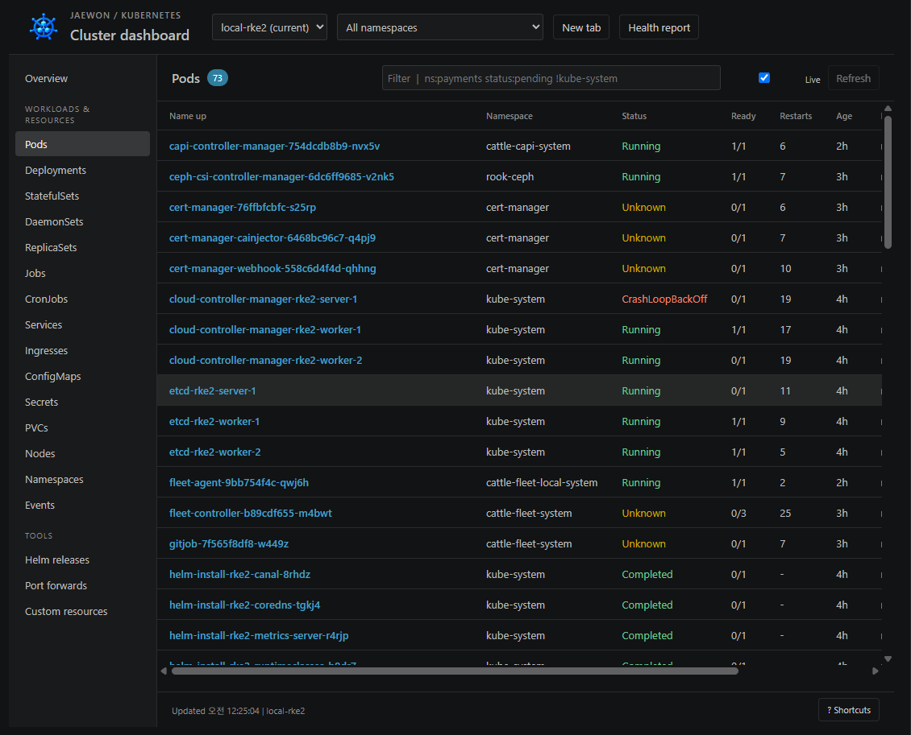
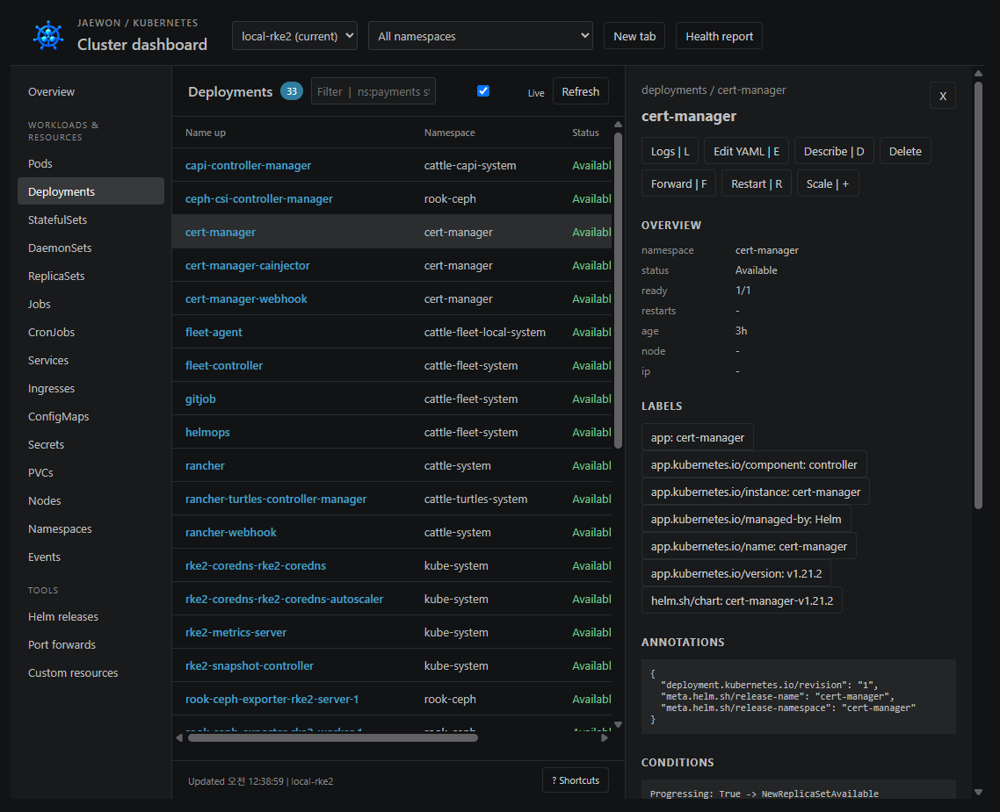
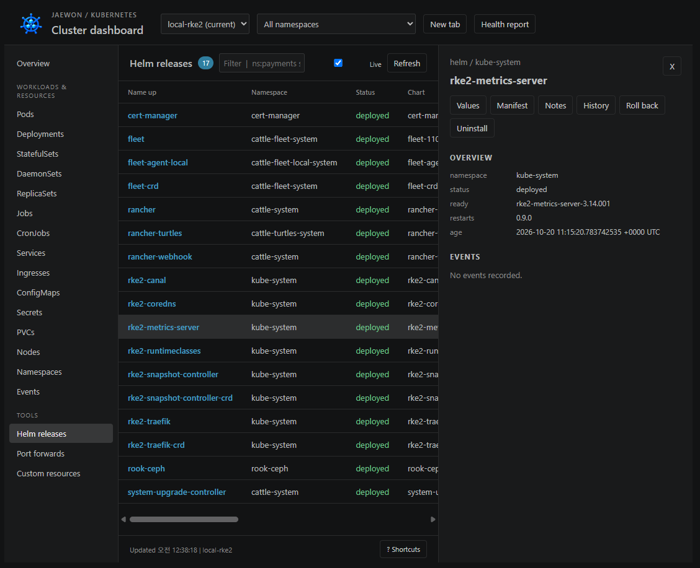

# Jaewon K8s Dashboard

[한국어](https://github.com/david365-lee/persona/blob/main/README.md) · [English](https://github.com/david365-lee/persona/blob/main/README.en.md) · [日本語](https://github.com/david365-lee/persona/blob/main/README.ja.md) · [简体中文](https://github.com/david365-lee/persona/blob/main/README.zh-CN.md)

VS Code에서 실행하는 독립 Kubernetes 대시보드입니다.

한국인 개발자 **jaewon**이 만들어 무료로 배포하는 확장 프로그램입니다. MIT 라이선스로 제공합니다.

Created and distributed for free by **jaewon**, a developer from South Korea. Available under the MIT License.

[Marketplace에서 설치](https://marketplace.visualstudio.com/items?itemName=jaewon-lee.jaewon-k8s-dashboard) · [VSIX 다운로드](https://github.com/david365-lee/persona/releases/latest) · [프로젝트 안내](https://github.com/david365-lee/persona#readme)

## 빠른 시작

1. VS Code 1.90.0 이상과 `kubectl`, 접근할 클러스터의 kubeconfig를 준비합니다. Helm 기능에는 `helm`도 필요합니다.
2. VS Code 확장 화면에서 **Jaewon K8s Dashboard**를 검색하고, 확장 ID `jaewon-lee.jaewon-k8s-dashboard`를 확인하여 설치합니다.
3. 터미널에서 `kubectl config get-contexts`와 `kubectl get namespaces`로 연결을 확인합니다.

명령 팔레트에서 **Jaewon K8s: Open Dashboard**를 실행하거나 **Ctrl+Alt+J**를 누르세요. 왼쪽 활동 표시줄의 Jaewon K8s에서도 클러스터와 포트 포워드를 관리할 수 있습니다.

macOS 단축키는 **Cmd+Alt+J**입니다. 활동 표시줄이 보이지 않으면 **Jaewon K8s: Show Sidebar** 명령을 실행하세요.

## 기능

### 0.2.4 업데이트

세부정보에서 깨지던 이미지를 제거하고 실제 사용 화면 3장과 기능별 안내를 추가했습니다. 배포판의 이미지는 Marketplace에서 직접 제공하므로 GitHub 로그인 없이 볼 수 있습니다. 기존 연결 복구, 네임스페이스 복원 및 컨테이너 상태 개선도 포함합니다.

### 0.2.2 업데이트

- 첫 연결 실패 후 새로고침·자동 갱신으로 연결 설정과 네임스페이스 조회를 다시 시도합니다.
- 확장 프로그램·대시보드·탭 아이콘을 새 파란 클러스터 이미지로 교체하고 활동 표시줄 아이콘을 맞췄습니다.
- 연결 실패 원인을 상태 표시줄에 표시합니다. API 서버 또는 SSH 터널이 중단된 경우 해당 연결 복구가 필요합니다.

### 0.2.0 개선

Pod의 현재 장애와 과거 재시작 이력을 구분하고, init·사이드카의 준비 상태를 반영합니다. 상세 화면에서 일반·init·임시 컨테이너, 워크로드 템플릿 및 이전 종료 사유를 볼 수 있습니다. 대시보드 탭 복원, 숨겨진 화면의 자동 갱신 중지, 집합 기반 라벨 조건을 유지하는 셸 대상 선택을 추가했습니다. 생성한 아이콘은 대시보드 헤더와 탭에도 표시합니다.

[REA 심층 분석과 검증 기록](https://github.com/david365-lee/persona/blob/main/jaewon-k8s-dashboard/docs/rea-expansion-0.2.0.md)

- 컨텍스트별 독립 탭, 네임스페이스 선택, 리소스 검색·정렬·페이지 이동
- Pods, Deployments, StatefulSets, DaemonSets, ReplicaSets, Jobs, CronJobs, Services, Ingresses, ConfigMaps, Secrets, PVCs, Nodes, Namespaces, Events, CRDs
- 컨테이너·조건·이벤트·레이블·주석·Secret 개별 키 확인, CPU/메모리 이력과 제한값
- 여러 Pod/컨테이너의 실시간 로그, 이전 로그, 필터·정규식·강조·복사·저장
- 컨테이너 셸, YAML 편집/적용, 재시작·확장·삭제, CronJob 실행·중지, 노드 cordon/uncordon
- 자동 재연결·저장·자동 시작 포트 포워드 (127.0.0.1 바인딩)
- Helm 릴리스·values·manifest·notes·history·rollback·uninstall
- 장애 Pod·재시작 횟수·준비되지 않은 워크로드/노드의 Markdown 상태 보고서

## 화면 안내

아래 이미지는 2026년 10월 21일 사용자가 제공한 실제 `local-rke2` 클러스터 화면입니다. 촬영 당시의 상태이며, 현재 클러스터의 정상 여부를 나타내지는 않습니다. 리소스 이름·수·상태는 연결 환경에 따라 달라집니다.

### 리소스 탐색과 상태 확인

컨텍스트와 네임스페이스를 고르고 리소스를 검색·정렬합니다. Pod의 현재 장애와 과거 종료 이력을 구분하고, 컨테이너 준비 상태·재시작 수·노드·IP를 확인합니다.

- **컨텍스트 / 네임스페이스**: 상단에서 클러스터와 조회 범위를 선택합니다. **New tab**으로 다른 클러스터를 별도 탭에서 확인합니다.
- **Status / Ready / Restarts**: 현재 상태, 준비된 컨테이너 수, 누적 재시작 수를 함께 확인합니다. `Running`이어도 `Ready`가 `0/1`이면 아직 준비되지 않은 상태입니다. `Completed`는 작업 완료를 뜻합니다.
- **Unknown / CrashLoopBackOff**: 노드 연결과 컨테이너 상태를 확인한 뒤 해당 리소스의 로그·Describe·이벤트로 원인을 조사합니다. 화면의 장애 표시는 촬영 당시의 기록입니다.
- **검색 / 갱신**: `ns:payments`, `status:pending`, `!kube-system` 같은 필터를 조합합니다. **Live**로 자동 갱신하고 **Refresh**로 즉시 다시 조회합니다.
- **Health report**: 준비되지 않은 리소스와 장애 Pod를 Markdown 보고서로 확인합니다.

### Deployment 상세와 리소스 작업

목록에서 이름을 선택하면 오른쪽에 상세 패널이 열립니다. 아래 화면은 `cert-manager` Deployment의 상세 정보입니다.

- **Overview**: 네임스페이스, 상태, 준비된 복제본 수와 생성 후 경과 시간을 확인합니다.
- **Labels / Annotations / Conditions / Events**: 선택자와 Helm 관리 정보, 워크로드 조건 및 이벤트를 확인합니다. 컨테이너 영역에서는 일반·init·임시 컨테이너의 이미지·자원·현재 상태·이전 종료 사유를 볼 수 있습니다.
- **Logs / Edit YAML / Describe**: 로그 열기, YAML 편집·적용, kubectl 상세 진단을 실행합니다.
- **Restart / Scale / Delete**: 워크로드 재시작, 복제본 수 변경, 리소스 삭제를 실행합니다. 실행 가능 여부는 리소스 종류와 RBAC 권한에 따라 달라집니다.
- **Forward**: 지원하는 리소스의 포트를 로컬로 연결합니다. 패널의 **X**로 상세 보기를 닫습니다.

### Helm 릴리스 관리

왼쪽 **Helm releases**를 선택하면 릴리스 목록을 조회합니다. 아래 화면은 `kube-system`의 `rke2-metrics-server` 릴리스입니다.

- **Values / Manifest / Notes**: 설치 값, 배포된 Kubernetes 정의, 차트의 사용 안내를 엽니다.
- **History / Roll back**: 배포 이력을 확인하고 원하는 리비전으로 되돌립니다.
- **Uninstall**: 확인 후 선택한 릴리스를 제거합니다. 연결된 클러스터에서 `helm` 실행 파일과 필요한 권한이 있어야 합니다.
- 릴리스 목록에는 네임스페이스·배포 상태·차트 정보를 표시합니다. Helm 상세 패널의 항목 표시는 리소스 상세와 다를 수 있으므로 버전과 설정의 정확한 값은 **Values**, **Manifest**, **History**에서 확인하세요.

### 여러 컨테이너의 실시간 로그

여러 Pod와 컨테이너의 로그를 모아서 보고, 이전 로그·검색·정규식·강조·복사·저장을 사용합니다.

### 포트 포워드

**Port forwards**에서 로컬 연결을 관리합니다. 포트 포워드는 `127.0.0.1`에 바인딩하고 저장·중지·재시작·브라우저 열기를 지원합니다. 저장한 연결의 자동 시작은 `jaewonK8s.autoStartPortForwards`로 설정합니다.

## 연결 설정과 복구

- 기본적으로 로컬 `kubectl`과 환경 변수 `KUBECONFIG` 또는 홈 디렉터리의 `.kube/config`를 사용합니다. 별도 파일은 `jaewonK8s.kubeconfig`에 지정하세요.
- k9s에서 `--kubeconfig`로 파일을 선택한다면 같은 파일을 설정하고 같은 컨텍스트를 선택하세요. 별도의 `kubectl` 경로가 필요하면 `jaewonK8s.kubectlPath`를 지정합니다.
- 첫 연결 실패 후 **Refresh**를 누르거나 **Live** 자동 갱신을 켜면 설정·컨텍스트·네임스페이스 조회를 다시 시도합니다.
- API 주소가 `127.0.0.1`이고 연결이 거부된다면 클러스터 접속에 사용하는 로컬 서비스나 SSH 터널이 실행 중인지 확인하세요. 대시보드는 해당 터널을 자동으로 생성하지 않습니다.
- 같은 kubeconfig와 컨텍스트로 `kubectl --context <컨텍스트> get namespaces`가 되는지 확인하세요. 리소스 조회와 작업에는 해당 사용자의 RBAC 권한이 적용됩니다.

## 설정

로컬 `kubectl`과 kubeconfig를 사용합니다. Helm 기능에는 `helm` 실행 파일이 필요합니다. VS Code 설정에서 `jaewonK8s.kubectlPath`, `jaewonK8s.helmPath`, `jaewonK8s.kubeconfig`를 지정할 수 있습니다. 나머지 설정은 `jaewonK8s.refreshSeconds`, `metrics`, `logTailLines`, `logMaxLines`, `autoStartPortForwards`입니다.

모든 클러스터 작업은 선택된 컨텍스트를 명시합니다. 기본 kubectl 컨텍스트 변경은 별도 명령입니다. 삭제·YAML 적용·Helm rollback/uninstall은 실행 전 확인합니다. 각 작업에는 기존 kubeconfig의 RBAC가 적용됩니다.

## 설치 및 개발

`npm run package`로 생성한 VSIX를 VS Code의 **Extensions: Install from VSIX...**로 설치합니다. 설치 후 **Developer: Reload Window**를 실행하면 새 확장을 로드합니다.

외부 런타임 의존성이나 빌드 과정 없이 Node.js CommonJS와 VS Code webview를 사용합니다. `npm test`로 명령 인수·선택자·작업 검증 테스트를 실행합니다.

## 분석 범위

설치된 utiltools Kubernetes Dashboard 1.0.4를 REA로 정적 분석하고 manifest/README의 기능을 독립 구현했습니다. 원본 코드와 자산을 포함하지 않습니다. 원본의 실행 결과와 완전한 동등성은 검증되지 않았습니다. 테이블은 150행 단위 페이지 방식이며 메트릭 이력은 상세 화면이 열린 동안 수집합니다. 분석 근거·제한은 `docs/`를 참고하세요.
