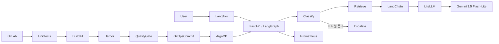

# LLMOps Support Assistant

고객 문의를 분류하고 버전 관리된 정책을 검색해 답변하는 실행 가능한 LLMOps 샘플입니다.
모델을 직접 학습하는 프로젝트가 아니라 외부 LLM의 프롬프트·데이터·평가·배포를 관리합니다.



## 연결된 서비스

| 역할 | 위치 |
| --- | --- |
| GitLab 소스·CI·평가 보고서 | https://gitlab.clush.cloud/root/llmops-support-assistant |
| 샘플 Swagger / API | https://llmops.clush.cloud/docs |
| Langflow | https://langflow.clush.cloud — `LLMOps Support Assistant` 플로우 |
| LiteLLM | https://litellm.clush.cloud/ui/ |
| Harbor 이미지 | https://harbor.clush.cloud — `llmops/support-assistant` |
| Argo CD Application | https://argocd.clush.cloud/applications/llmops-support-assistant |
| 관측 | https://prometheus.clush.cloud / https://grafana.clush.cloud |

[Langflow 샘플 플로우](https://langflow.clush.cloud/flow/5d70ee54-92c2-48ff-9c0f-17aa8457f641)의 Chat Input → Support Assistant (LangGraph) → Chat Output으로 질문하세요.
예: `환불은 며칠 이내 신청하나요?`, `배송 기간은?`, `비밀번호를 잊어버렸어요`.
Langflow는 배포된 API를 호출하므로 GitLab에서 승격한 동일한 그래프·프롬프트·이미지를 사용합니다.
미지원 질문은 LLM을 호출하지 않고 고객센터로 안내합니다.

## CI/CD와 품질 게이트

1. `main` 커밋 → 보호된 프로젝트 전용 Runner에서 단위 테스트 실행.
2. rootless BuildKit으로 OCI 이미지를 빌드하여 Harbor에 전체 커밋 SHA 태그로 푸시.
3. 같은 이미지로 `evals/cases.json` 온라인 평가 실행. 분류, 필수 정책 사실, 출처,
   프롬프트 주입 대응, 응답 지연을 검사하며 **5/5 통과**해야 승격합니다.
4. 보호된 CI 변수를 사용해 Kustomize 이미지 태그와 `RELEASE_SHA`를 Git에 커밋.
   `chore(deploy):` 커밋은 재귀 파이프라인을 만들지 않습니다.
5. Argo CD가 Git을 감지해 동기화하고, 마지막 CI 작업이 실제 배포 SHA와 Gemini 응답을 확인합니다.
   성공한 배포는 GitLab의 `sample` Environment에도 기록됩니다.

CI의 Tests 탭에서 JUnit 결과를, 각 작업의 Artifacts에서 `quality.json`, `quality.xml`,
`promotion.json`, `deployment.json`을 확인하세요. 평가 보고서에는 모델·프롬프트 버전,
프롬프트/데이터셋 해시, 커밋, 케이스별 결과와 지연이 기록됩니다.
이는 작은 회귀 평가이며 실제 서비스 품질이나 완전한 프롬프트 주입 방어를 보장하지 않습니다.
병렬 파이프라인에서 이전 커밋이 최신 버전을 덮어쓰지 않도록 승격 작업은 직렬 실행되고 최신 HEAD를 확인합니다.

## API 사용

앱의 Bearer 토큰은 저장소에 없으며 Kubernetes `llmops-sample/support-assistant-auth`에 저장됩니다.
Swagger의 Authorize에 이 Secret의 `APP_API_TOKEN`을 입력한 뒤 `POST /api/assist`를 실행하세요.

```bash
curl https://llmops.clush.cloud/api/assist \
  -H "Authorization: Bearer $APP_API_TOKEN" \
  -H 'Content-Type: application/json' \
  -d '{"question":"환불은 며칠 이내 신청하나요?"}'
```

응답에는 `answer`, `category`, `sources`, `steps`, `model`, `prompt_version`, `release`, `latency_ms`가 포함됩니다.
`/health/ready`는 설정·프로세스 준비 상태를 검사하며 외부 모델 호출 가능 여부는 CI의 온라인 평가와 배포 검증이 검사합니다.
`/metrics`에서 요청 수, 실패 수, 지연 분포를 수집합니다. 본문·API 키는 앱 로그에 기록하지 않습니다.

## 수정·실험·롤백

- 정책: `data/knowledge.json`, 프롬프트: `prompts/support-v1.txt`, 그래프: `app/graph.py`.
- 정책/프롬프트 변경 시 평가 데이터도 검토하고 버전을 올리세요. 평가 통과 없이 배포하지 않습니다.
- 모델은 LiteLLM 모델 이름과 `LLM_MODEL`로 지정하며 기본값은 `gemini-3.5-flash-lite`입니다.
- 롤백은 배포 매니페스트를 이전에 평가 통과한 SHA 태그와 `RELEASE_SHA`로 변경하고
  `chore(deploy): rollback to <SHA>` 메시지로 커밋하세요. 이 메시지는 빌드 파이프라인을
  다시 만들지 않으므로 Argo CD가 이전 이미지를 유지합니다. 코드 자체를 되돌려 새로 검증하려면
  해당 코드 커밋을 revert하고 일반 파이프라인을 실행하세요.
- `langflow/support-assistant-flow.json`은 비밀 정보가 없는 가져오기용 플로우입니다.
  `langflow/support_gateway.py`와 `scripts/configure_langflow.py`로 현재 서버 스키마에 맞게 재생성할 수 있습니다.

## 로컬 실행

Python 3.12에서 가상환경을 생성하고 의존성을 설치합니다.

```bash
pip install -r requirements-dev.txt
python -m pytest tests -q
export LITELLM_BASE_URL=https://llmapi.clush.cloud/v1
export LITELLM_API_KEY='<sample virtual key>'
export APP_API_TOKEN='<your local token>'
uvicorn app.main:app --port 8000
python -m app.evaluate --output reports
```

원본 Gemini 키 대신 프로젝트 전용 LiteLLM 가상 키를 사용합니다. 이 키는 허용 모델을 제한하고
30일당 $1 예산과 90일 만료를 갖습니다. 예산은 비용 상한을 보조하는 프록시 제어이며
Google 무료 티어를 보장하지 않습니다. 실제 과금은 Google 계정과 사용량을 확인하세요.

## 플랫폼 운영 경계

- 애플리케이션은 `llmops-sample`, Runner는 `llmops-ci` 네임스페이스에 있습니다.
- 공통 F5 NGINX Ingress 및 기존 Cloudflare 정책을 사용하며 별도 공개 LoadBalancer는 없습니다.
- CI의 GitOps API 호출은 `GITLAB_INTERNAL_API_URL`로 내부 GitLab Service를 사용합니다.
  공개 GitLab 주소는 브라우저와 Git clone에 유지하며, Cloudflare에서 차단하는 Python API 요청을
  허용하도록 에지 보안 정책을 변경하지 않습니다.
- 비공개 GitLab과 Harbor 프로젝트를 사용합니다. Argo CD는 저장소 읽기 전용 deploy token,
  Harbor는 push/pull 로봇 계정을 분리하고 CI 변수는 masked/protected로 저장합니다.
- Runner는 동시 작업 1개이며 CI 네임스페이스 안에서만 Pod를 관리합니다. Docker 소켓과
  privileged 컨테이너를 사용하지 않습니다. rootless BuildKit을 위해 CI Pod의 seccomp는 Unconfined입니다.
  이 Runner를 다른 프로젝트/비신뢰 브랜치와 공유하지 마세요.
- 플랫폼 초기화·Secret 관리 스크립트는 상위 운영 저장소의 `deploy/llmops/`에 있습니다.
  샘플 저장소에는 관리자 비밀번호, Harbor 로봇 비밀, LiteLLM 키, GitLab 토큰을 넣지 않습니다.
- 토큰은 90일 후 만료됩니다. GitLab 전용 토큰/Argo deploy token/Harbor 로봇/LiteLLM 가상 키를
  갱신하면 관련 Kubernetes Secret과 GitLab CI 변수도 함께 갱신해야 합니다.
- 단일 노드·단일 replica 샘플입니다. 고가용성, 독립 DB 백업, 운영 승인, 대규모 평가,
  실제 사용자 데이터 마스킹은 운영 전 별도 설계가 필요합니다.
